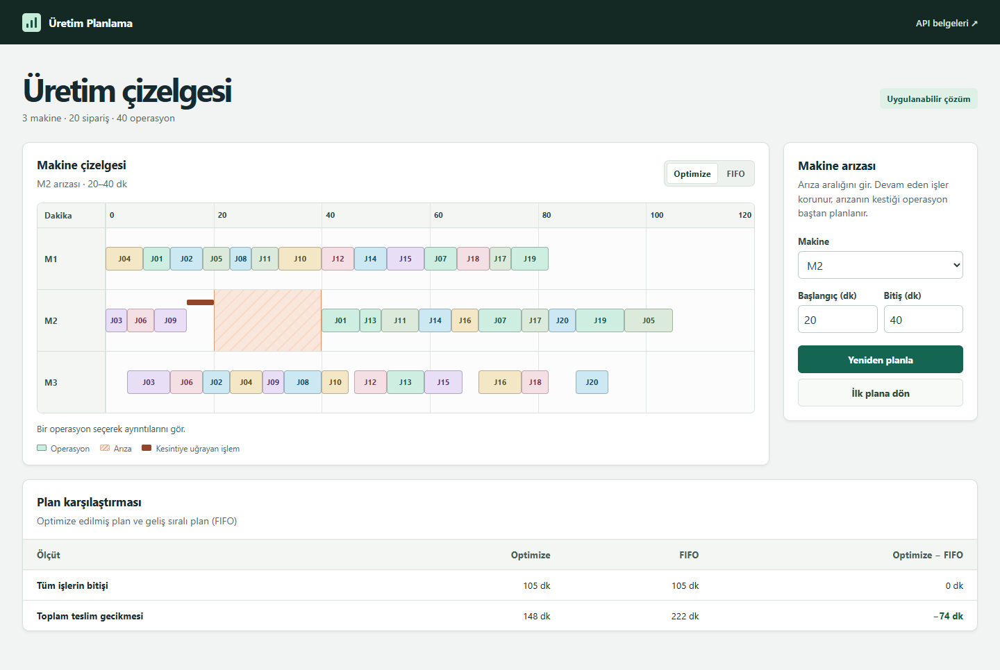

# Production Scheduler

Makine arızası sonrası üretimi yeniden çizelgeleyen bir job-shop simülatörü. Örnek fabrika üç makine ve 20 sipariş içerir. Tarayıcıdan bir makine ve arıza aralığı seçerek hangi işlerin korunduğunu, hangilerinin yeniden başlatıldığını ve yeni planın FIFO ile karşılaştırmasını görebilirsiniz.



## Çalıştırma

Python 3.11 ile depo kökünde:

```sh
python -m venv .venv
```

Sanal ortamı Windows PowerShell'de `.\.venv\Scripts\Activate.ps1`, Linux veya macOS'ta `source .venv/bin/activate` ile etkinleştirin.

```sh
python -m pip install -r requirements.txt
python -m uvicorn app.main:app
```

Arayüz [localhost:8000](http://127.0.0.1:8000), API sözleşmesi [localhost:8000/docs](http://127.0.0.1:8000/docs) adresindedir.

## Çizelgeleme kuralları

- Her operasyon, uygun makinelerden birinde kesintisiz çalışır. Bir makine aynı anda tek operasyon yürütür. Sipariş içindeki operasyon sırası korunur.
- OR-Tools CP-SAT önce toplam gecikmeyi, eşitlik durumunda son bitiş zamanını en aza indirir. Gecikme, siparişin teslim zamanını aşan dakika sayısıdır.
- Arıza aralığı `[başlangıç, bitiş)` olarak uygulanır. Başlamış işler yerinde kalır. Arızalı makinede yarıda kesilen operasyon, arıza bitiminden sonra uygun bir makinede tam süresiyle baştan çalışır.
- Arıza sonrası CP-SAT ve FIFO aynı başlangıç planının gerçekleşmiş kısmını paylaşır. FIFO referansı, en erken başlayabilen operasyona öncelik verir. Eşitlikte operasyonun hazır olduğu zaman ve siparişin giriş sırası belirleyicidir.
- `optimal` çözücünün optimumu kanıtladığını, `feasible` geçerli bir plan ürettiğini belirtir. `unknown` ayrılan çözüm bütçesinde durumun belirlenemediğini gösterir.

[OR-Tools job-shop modelleme rehberi](https://developers.google.com/optimization/scheduling/job_shop)

## Örnek sonuç

| Senaryo | CP-SAT durumu | Son bitiş (CP-SAT / FIFO) | Toplam gecikme (CP-SAT / FIFO) |
| --- | --- | ---: | ---: |
| İlk plan | Optimum | 91 / 91 dk | 6 / 87 dk |
| M2 arızası, 20–40. dakika | Uygulanabilir | 105 / 105 dk | 148 / 222 dk |

Arıza, J01 siparişinin ikinci operasyonunu 20. dakikada keser. Sonuçlar depodaki örnek veriye aittir.

## API

| Uç nokta | İşlev |
| --- | --- |
| `GET /health` | Servisin erişilebilirliği |
| `GET /api/scenario` | Örnek fabrika, makineler ve siparişler |
| `POST /api/schedule` | `scenario` ve isteğe bağlı `outage` ile plan üretimi |

Arıza örneği: `{"machine_id":"M2","start":20,"end":40}`. Zamanlar üretimin başlangıcından itibaren dakika cinsindendir.

## Test

```sh
python -m pip install -r requirements-dev.txt
python -m pytest -q
```

Bu ilk sürüm, temsili siparişlerle çalışan, durum saklamayan bir simülasyondur. Sonraki geliştirme adımları sürümlü plan kaydı, acil sipariş olayları ve standart job-shop örnekleriyle performans karşılaştırmasıdır.
