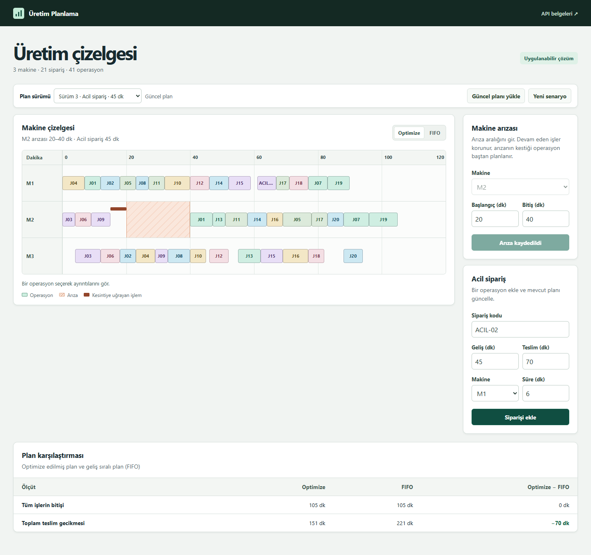

# Production Scheduler

Makine arızası ve acil sipariş sonrası üretimi yeniden çizelgeleyen bir job-shop simülatörü. Üç makine ve 20 sipariş içeren örnek fabrikada olay ekleyebilir, planları FIFO ile karşılaştırabilir ve önceki sürümleri inceleyebilirsiniz.



## Çalıştırma

Python 3.11 ile depo kökünde:

```sh
python -m venv .venv
```

Sanal ortamı Windows PowerShell'de `.\.venv\Scripts\Activate.ps1`, Linux veya macOS'ta `source .venv/bin/activate` ile etkinleştirin.

```sh
python -m pip install -r requirements.txt
python -m uvicorn app.main:app
```

Arayüz [localhost:8000](http://127.0.0.1:8000), API sözleşmesi [localhost:8000/docs](http://127.0.0.1:8000/docs) adresindedir.

## Çizelgeleme kuralları

- Her operasyon, uygun makinelerden birinde kesintisiz çalışır. Bir makine aynı anda tek operasyon yürütür. Sipariş içindeki operasyon sırası korunur.
- OR-Tools CP-SAT önce toplam gecikmeyi, eşitlik durumunda son bitiş zamanını en aza indirir. Gecikme, siparişin teslim zamanını aşan dakika sayısıdır.
- Arıza aralığı `[başlangıç, bitiş)` olarak uygulanır. Başlamış işler yerinde kalır. Arızalı makinede yarıda kesilen operasyon, arıza bitiminden sonra uygun bir makinede tam süresiyle baştan çalışır.
- Arıza sonrası CP-SAT ve FIFO aynı başlangıç planının gerçekleşmiş kısmını paylaşır. FIFO referansı, en erken başlayabilen operasyona öncelik verir. Eşitlikte operasyonun hazır olduğu zaman ve siparişin giriş sırası belirleyicidir.
- Acil sipariş olayında gerçekleşmiş kısım kayıtlı son plandan alınır. Eklenen operasyonlar olay dakikasından önce başlayamaz. Var olan arıza aralığı ve kesilen işler için yeniden başlama sınırı korunur.
- `optimal` çözücünün optimumu kanıtladığını, `feasible` geçerli bir plan ürettiğini belirtir. `unknown` ayrılan çözüm bütçesinde durumun belirlenemediğini gösterir.

[OR-Tools job-shop modelleme rehberi](https://developers.google.com/optimization/scheduling/job_shop)

## Örnek sonuç

| Senaryo | CP-SAT durumu | Son bitiş (CP-SAT / FIFO) | Toplam gecikme (CP-SAT / FIFO) |
| --- | --- | ---: | ---: |
| İlk plan | Optimum | 91 / 91 dk | 6 / 87 dk |
| M2 arızası, 20–40. dakika | Uygulanabilir | 105 / 105 dk | 148 / 222 dk |
| Arıza sonrası ACIL-01, 45. dakika | Uygulanabilir | 105 / 105 dk | 151 / 221 dk |

Arıza, J01 siparişinin ikinci operasyonunu 20. dakikada keser. M1'e eklenen ACIL-01, 61–67. dakikalar arasında çalışır ve 70. dakikadaki teslim hedefine yetişir. Sonuçlar depodaki örnek veriye aittir.

## Plan geçmişi

Her olay, senaryoyu ve hesaplanan planı içeren yeni bir sürüm kaydeder. Önceki sürümler arayüzde salt okunur olarak açılır. Tarayıcı son çalışma alanını hatırlar ve SQLite kayıtları sunucu yeniden başladığında korunur.

- Kayıt dosyası varsayılan olarak `data/plans.sqlite3` konumundadır. `PRODUCTION_SCHEDULER_DB` ile başka bir dosya seçilebilir.
- Olay dakikaları geriye gidemez. Çalışma alanı başına bir makine arızası ve birden fazla acil sipariş eklenebilir.
- Olay isteği `expected_version` taşır. Sürüm değiştiyse API HTTP 409 döndürür. Çözücü veritabanı yazma kilidini tutmadan çalışır. Sürüm kontrolü ve kayıt tek SQLite işleminde yapılır.
- Arayüz tek operasyonlu acil sipariş girer. API, sıralı birden fazla operasyonu ve operasyon başına alternatif makineleri kabul eder.

Yerel simülasyon, temsili siparişler ve tek sunucu veritabanı varsayımıyla çalışır.

## API

| Uç nokta | İşlev |
| --- | --- |
| `GET /health` | Servisin erişilebilirliği |
| `GET /api/scenario` | Örnek fabrika, makineler ve siparişler |
| `POST /api/schedule` | `scenario` ve isteğe bağlı `outage` ile plan üretimi |
| `POST /api/workspaces` | `scenario` ile ilk kayıtlı planı oluşturma |
| `GET /api/workspaces/{id}` | Geçerli planı okuma |
| `GET /api/workspaces/{id}/versions` | Plan geçmişini listeleme |
| `GET /api/workspaces/{id}/versions/{version}` | Eski bir planı okuma |
| `POST /api/workspaces/{id}/events` | `outage` veya `urgent_job` olayıyla yeni sürüm oluşturma |

Arıza örneği: `{"machine_id":"M2","start":20,"end":40}`. Zamanlar üretimin başlangıcından itibaren dakika cinsindendir.

## Test

```sh
python -m pip install -r requirements-dev.txt
python -m pytest -q
```

## OR-Library karşılaştırması

[jobshop1.txt](https://people.brunel.ac.uk/~mastjjb/jeb/orlib/files/jobshop1.txt) dosyasını indirip şu komutu çalıştırın.

```sh
python -m app.benchmark jobshop1.txt ft06 la01 la06
```

Klasik job-shop örneklerinde teslim tarihi bulunmadığı için bu ölçümün hedefi tüm işlerin bitiş süresidir.

| Senaryo | CP-SAT durumu | CP-SAT | FIFO |
| --- | --- | ---: | ---: |
| ft06 | Optimum | 55 | 65 |
| la01 | Optimum | 666 | 772 |
| la06 | Optimum | 926 | 926 |
